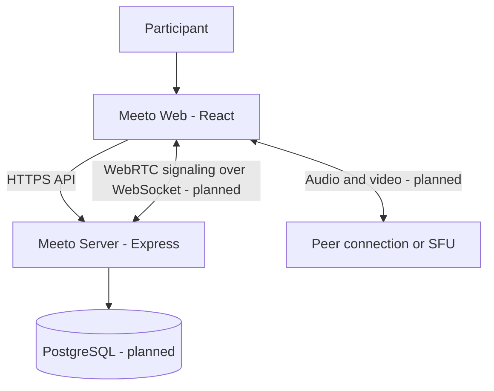

# Meeto Web

> **Meet without limits.**  
> A thoughtful, browser-first video meeting experience designed to make joining a conversation feel effortless.

Meeto is a web-based video meeting project. This repository contains the user-facing application: the landing page, meeting entry experience, and the interface that will connect to Meeto's API and real-time media layer.

The project is being built in stages. The current scaffold provides a runnable React application and a clear foundation for meeting features; it does **not** yet implement a complete production video call.

<p align="center">
  <a href="https://github.com/jinn-0901/meeto-web"><strong>Web repository</strong></a>
  &nbsp; · &nbsp;
  <a href="https://github.com/jinn-0901/meeto-server">Backend repository</a>
</p>

---

## At a glance

| Item | Details |
| --- | --- |
| Product | Meeto — browser-based video meetings |
| Repository | `jinn-0901/meeto-web` |
| Application | React + TypeScript + Vite |
| Styling | Plain CSS with responsive layouts |
| API client | `src/lib/api.ts` |
| Development server | Vite |
| Current status | Initial scaffold; meeting media features are planned |

## Product principles

- **Easy to join:** keep the path from opening the website to entering a meeting simple.
- **No arbitrary free-meeting time cap:** this is a product goal. Real usage still depends on infrastructure capacity, fair-use protections, and operating costs.
- **Browser first:** prioritize modern desktop and mobile browsers before considering a dedicated app.
- **Clear by design:** make camera, microphone, and meeting state understandable to participants.
- **Privacy conscious:** request device permissions only when the user chooses to use them.

## Planned experience

- Create or join a meeting using a shareable link.
- Preview camera and microphone before joining.
- View participants and manage local audio/video.
- Share a screen where supported by the browser.
- Handle reconnects, device errors, and permission denials gracefully.
- Support responsive layouts, keyboard access, and dark-mode preferences.

These are planned capabilities, not claims that every feature is already implemented.

## Architecture



- **Web app:** user interface, device controls, and client-side meeting state.
- **Server:** meeting authorization, room membership, and signaling coordination.
- **Media transport:** WebRTC carries audio/video. Multi-participant production calls may require an SFU and TURN infrastructure.
- **Database:** persistent users and meeting records can be added when the product requirements are finalized.

The web app and server are maintained in separate repositories and should be configured through environment variables rather than hard-coded deployment URLs.

## Run locally

### Requirements

- Node.js 20 or later
- npm
- The Meeto server for API-backed features (the current starter screen can be explored without a running API)

### 1. Clone and install

```bash
git clone https://github.com/jinn-0901/meeto-web.git
cd meeto-web
npm install
```

### 2. Configure the API URL

Copy `.env.example` to `.env.local`:

```bash
cp .env.example .env.local
```

Set the server's base URL:

```dotenv
VITE_API_BASE_URL=http://localhost:4000
```

Vite exposes variables prefixed with `VITE_` to browser code. **Never put passwords, private API keys, or server secrets in this file.**

### 3. Start the development server

```bash
npm run dev
```

Open the local URL printed by Vite, usually [http://localhost:5173](http://localhost:5173).

### 4. Check code quality and build

```bash
npm run typecheck
npm run build
npm run preview
```

The production build is written to `dist/`.

## Project structure

```text
public/
  favicon.svg
src/
  App.tsx                 # Landing page and primary interaction
  main.tsx                # React entry point
  styles.css              # Responsive visual system
  lib/
    api.ts                # Typed API request helper
.env.example              # Public configuration example
index.html                # Browser document
package.json              # Scripts and dependencies
vite.config.ts            # Local development configuration
tsconfig.json             # TypeScript settings
```

Keep feature-specific code together as the application grows. Meeting UI, media-device handling, and WebRTC connection logic should be added as separate modules rather than accumulating in `App.tsx`.

## API connection

The client reads `VITE_API_BASE_URL` and uses `src/lib/api.ts` for requests. The server currently provides a health endpoint:

| Method | Path | Purpose |
| --- | --- | --- |
| `GET` | `/api/health` | Check that the API process is responding |

Meeting endpoints and WebSocket signaling will be documented here when they are implemented. Keep this table synchronized with the server README and actual routes.

## Troubleshooting

- **The page does not start:** confirm Node.js is version 20 or later, then run `npm install`.
- **API requests fail:** check `VITE_API_BASE_URL`, the server status, and the server's allowed frontend origin.
- **Environment changes do not apply:** restart the Vite development server.
- **A browser blocks camera or microphone access:** grant permission in browser settings and use HTTPS in deployed environments. Localhost is treated as a secure context by modern browsers.
- **The page builds but a meeting does not connect:** a working UI is not enough; WebRTC signaling, ICE configuration, and (for restrictive networks) TURN infrastructure must also be configured.

## Security and privacy

- Never commit `.env.local`, credentials, access tokens, or private keys.
- Treat all browser input as untrusted; the server must enforce meeting access and authorization.
- Ask for camera and microphone access only in response to a clear user action.
- Do not log media, access tokens, or private meeting content.
- Deploy over HTTPS and review dependency updates before release.

## Roadmap

1. Landing page and API health check.
2. Create/join meeting flow and server-side room lifecycle.
3. Device preview and one-to-one WebRTC call.
4. Multi-participant media architecture, likely using an SFU.
5. Screen sharing, reconnect behavior, accessibility, and production deployment.

---

<p align="center"><sub>Meeto — make room for better conversations, without arbitrary meeting timers.</sub></p>
